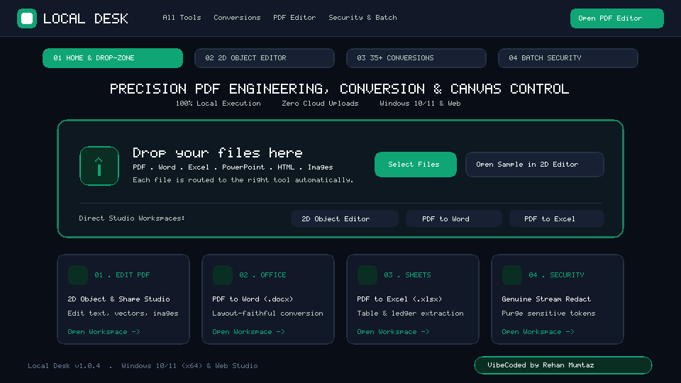

  

  <h1>Local Desk</h1>
  
<strong>Edit, convert, and secure documents privately on your own machine.</strong>

  

    
    
    
    
    
  

  

    ⬇️ <a href="https://github.com/r3haanM/LocalDesk/releases/latest"><strong>Download Desktop App</strong></a> · 💻 <a href="https://github.com/r3haanM/LocalDesk"><strong>GitHub Repository</strong></a>
  

  <picture>
    <source media="(prefers-color-scheme: dark)" srcset="docs/screenshots/overview-dark.gif" />
    <source media="(prefers-color-scheme: light)" srcset="docs/screenshots/overview-light.gif" />
    
  </picture>

## ✨ Features

- ✏️ **2D Object & Shape Editor:** Edit native PDF text runs, vector shapes, images, and page order directly on a live 2D canvas.
- 🔄 **Document Conversions:** Convert between PDF, Word (`.docx`), Excel (`.xlsx`), PowerPoint (`.pptx`), HTML, and images with offline OCR.
- 🛡️ **Batch Security Queue:** Apply stream redaction, SHA-256 signatures, password encryption, and watermarks across multiple files.
- 🔒 **100% Local & Offline:** Every document is processed in local memory with zero cloud uploads, zero telemetry, and bundled WASM models.
- 🌗 **Dark & Light Studio Themes:** Switch instantly between the `#090D16` obsidian dark workspace and high-contrast daylight mode.
- 🌐 **Windows Desktop + Browser:** Install the native Windows x64 desktop app or run the full studio locally in any browser.

## 📦 Install

> ℹ️ Windows 10 / 11 (x64) only — Windows 7 / 8 / 8.1 are not supported by the bundled runtime.

<table>
  <thead>
    <tr>
      <th width="50%" align="left">🪟 WINDOWS DESKTOP (.EXE &amp; .ZIP)</th>
      <th width="50%" align="left">🌐 ANY OS · IN BROWSER</th>
    </tr>
  </thead>
  <tbody>
    <tr>
      <td valign="top">
        
1. <strong>Windows Setup (<code>.exe</code>):</strong> Download <a href="https://github.com/r3haanM/LocalDesk/releases/latest/download/Local-Desk-Setup-1.0.5-x64.exe"><strong>Local-Desk-Setup-1.0.5-x64.exe</strong></a> and run the installer.

        
2. <strong>Single-File Portable (<code>.exe</code>):</strong> Download <a href="https://github.com/r3haanM/LocalDesk/releases/latest/download/Local-Desk-Portable-1.0.5-x64.exe"><strong>Local-Desk-Portable-1.0.5-x64.exe</strong></a> — runs without installing.

        
3. <strong>Portable Bundle (<code>.zip</code>):</strong> Download <a href="https://github.com/r3haanM/LocalDesk/releases/latest/download/Local-Desk-Portable-1.0.5-win-x64.zip"><strong>Local-Desk-Portable-1.0.5-win-x64.zip</strong></a>, extract anywhere, and launch <code>Local Desk.exe</code>.

        

          
<strong>SmartScreen &amp; SHA-256 verification</strong>

          
If Windows SmartScreen appears on unsigned builds, click <strong>More info → Run anyway</strong> (see <a href="#%EF%B8%8F-troubleshooting">Troubleshooting</a> below). Verify your download against <a href="https://github.com/r3haanM/LocalDesk/releases/latest/download/SHA256SUMS.txt"><code>SHA256SUMS.txt</code></a>:

          <pre><code>certutil -hashfile Local-Desk-Setup-1.0.5-x64.exe SHA256</code></pre>
        

      </td>
      <td valign="top">
        
1. Prerequisite: <strong>Node.js 18+</strong> (Windows, macOS, or Linux).

        
2. Clone, install dependencies, and start the dev server:

        <pre><code>git clone https://github.com/r3haanM/LocalDesk.git
cd LocalDesk && npm install
npm run dev</code></pre>
        
3. Open <a href="http://localhost:3000"><strong>http://localhost:3000</strong></a> in your browser.

      </td>
    </tr>
  </tbody>
</table>

## 🛠️ Troubleshooting

### Windows SmartScreen — "Windows protected your PC"

The Windows desktop build is unsigned, so SmartScreen shows a one-time warning on first launch. This is expected for unsigned installers — the file itself is verified and hash-published in `SHA256SUMS.txt`. Two clicks and you're in:

1. On the **"Windows protected your PC"** dialog, click **More info**.
2. Click **Run anyway** — the installer launches normally.

<picture>
  
</picture>

## 🔗 Links

- 🚀 [**All Releases**](https://github.com/r3haanM/LocalDesk/releases) — binaries, `SHA256SUMS.txt`, release notes
- 🤝 [**Contributing**](./CONTRIBUTING.md): Local setup, automated QA validation suite, and pull request workflow.
- 🛡️ [**Security Policy**](./SECURITY.md): Air-gapped execution guarantees, vulnerability reporting, and [AV False-Positive Guide](./docs/AV-FALSE-POSITIVE.md).
- 📄 [**License**](./LICENSE): Released under the MIT License.

---

  
<strong>Your documents. Your device. Your control.</strong>

  

    Released under the <a href="./LICENSE">MIT License</a> · VibeCoded by <a href="https://github.com/r3haanM">Rehan Mumtaz</a> ·
    <a href="https://x.com/cyber_cypher007">X</a> ·
    <a href="https://linkedin.com/in/rehan-mumtaz">LinkedIn</a> ·
    <a href="https://rehanmumtaz.medium.com">Medium</a>
  

