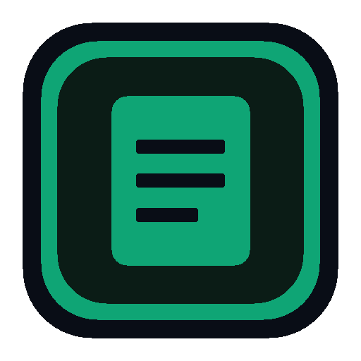

  

  <h1>Local Desk</h1>
  
<strong>Edit, convert, and secure documents — privately, on your own machine.</strong>

  

    
    
    
    
    
  

  <picture>
    <source media="(prefers-color-scheme: dark)" srcset="docs/screenshots/overview-dark.gif" />
    <source media="(prefers-color-scheme: light)" srcset="docs/screenshots/overview-light.gif" />
    
  </picture>

## ✨ Features

- ✏️ **2D Object & Shape Editor** — Edit native PDF text runs, vector shapes, images, and page order directly on a live 2D canvas.
- 🔄 **35+ Document Conversions** — Convert between PDF, Word (`.docx`), Excel (`.xlsx`), PowerPoint (`.pptx`), HTML, and images with offline OCR.
- 🛡️ **Batch Security Queue** — Apply genuine stream redaction, SHA-256 signatures, password encryption, and watermarks across multiple files.
- 🔒 **100% Local & Offline** — Every document is processed in local memory with zero cloud uploads, zero telemetry, and bundled WASM models.
- 🌗 **Dark & Light Studio Themes** — Switch instantly between the `#090D16` obsidian dark workspace and high-contrast daylight mode.
- 🌐 **Windows Desktop + Browser** — Install the native Windows x64 desktop app or run the full studio locally in any browser on Windows, macOS, or Linux.

## 📦 Install

<table>
  <thead>
    <tr>
      <th width="50%" align="left">🪟 WINDOWS DESKTOP (.EXE &amp; STANDALONE)</th>
      <th width="50%" align="left">🌐 ANY OS — IN BROWSER</th>
    </tr>
  </thead>
  <tbody>
    <tr>
      <td valign="top">
        
1. <strong>Windows Setup (<code>.exe</code>):</strong> Download <a href="https://github.com/rehanmumtaz/local-desk/releases/latest/download/Local-Desk-Setup-1.0.4-x64.exe"><strong>Local-Desk-Setup-1.0.4-x64.exe</strong></a> (<a href="./release/Local-Desk-Setup-1.0.4-x64.exe">repo binary</a>) and run the installer.

        
2. <strong>Standalone Portable (<code>.zip</code>):</strong> Download <a href="https://github.com/rehanmumtaz/local-desk/releases/latest/download/Local-Desk-Portable-1.0.4-win-x64.zip"><strong>Local-Desk-Portable-1.0.4-win-x64.zip</strong></a> (<a href="./release/Local-Desk-Portable-1.0.4-win-x64.zip">repo binary</a>), extract anywhere, and launch <code>Local Desk.exe</code>.

        

          
<strong>SmartScreen &amp; SHA-256 verification</strong>

          
If Windows SmartScreen appears on unsigned builds, click <strong>More info → Run anyway</strong>. Verify against <a href="./release/SHA256SUMS.txt"><code>SHA256SUMS.txt</code></a>:

          <pre><code>certutil -hashfile Local-Desk-Setup-1.0.4-x64.exe SHA256</code></pre>
        

      </td>
      <td valign="top">
        
1. Prerequisite: <strong>Node.js 18+</strong> (Windows, macOS, or Linux).

        
2. Clone, install dependencies, and start the dev server:

        <pre><code>git clone https://github.com/rehanmumtaz/local-desk.git
cd local-desk && npm install
npm run dev</code></pre>
        
3. Open <a href="http://localhost:3000"><strong>http://localhost:3000</strong></a> in your browser.

      </td>
    </tr>
  </tbody>
</table>

## 🔗 Links & Releases

- 📦 [**Windows Setup Installer (`.exe`)**](https://github.com/rehanmumtaz/local-desk/releases/latest/download/Local-Desk-Setup-1.0.4-x64.exe) · [**Standalone Portable (`.zip`)**](https://github.com/rehanmumtaz/local-desk/releases/latest/download/Local-Desk-Portable-1.0.4-win-x64.zip) · [**`SHA256SUMS.txt`**](./release/SHA256SUMS.txt) ([All Releases](https://github.com/rehanmumtaz/local-desk/releases))
- 🤝 [**Contributing**](./CONTRIBUTING.md) — Local setup, automated 28-case QA validation suite, and pull request workflow.
- 🛡️ [**Security Policy**](./SECURITY.md) — Air-gapped execution guarantees, vulnerability reporting, and [AV False-Positive Guide](./docs/AV-FALSE-POSITIVE.md).
- 📄 [**License**](./LICENSE) — Released under the MIT License.

---

  
<strong>Your documents, your machine, your control.</strong>

  
Released under the <a href="./LICENSE">MIT License</a> · VibeCoded by <a href="https://github.com/rehanmumtaz">Rehan Mumtaz</a>

  
Code signing credit: Free code signing on Windows provided by <a href="https://signpath.io">SignPath.io</a>, certificate by <a href="https://signpath.org">SignPath Foundation</a> (placeholder).

